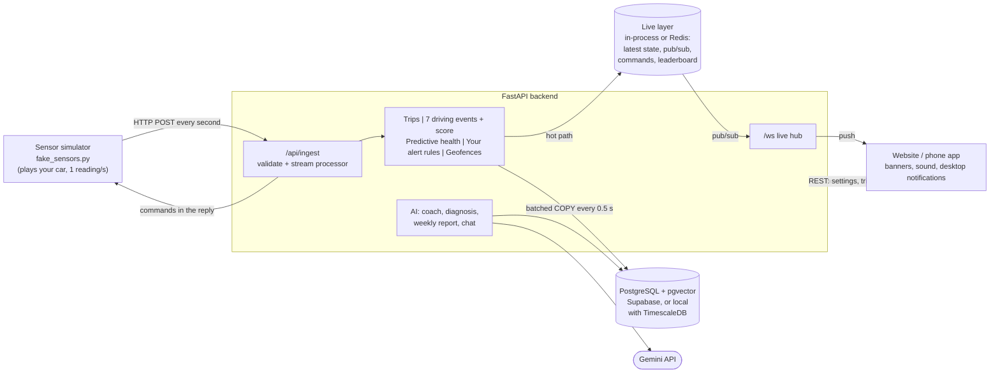

# DriveSense - monitor your car, get alerted before it breaks, and let AI explain it

DriveSense is a website (that also installs as a phone app) for monitoring **one personal car**.

Your car streams sensor data every second. The site shows:
- live status and location;
- trips and a driving score;
- the car's health.

It **raises alerts the moment something needs your attention**, often *before* a limit is crossed. You decide on the site what should trigger an alert. Generative AI (Gemini + RAG) explains your driving and diagnoses problems using your car's own data.

No hardware is needed. A separate *sensor simulator* plays the car and talks to the backend exactly like a real in-car telematics unit would.

| | |
|---|---|
| **Frontend** | React 19 + Vite: responsive website (sidebar on desktop, bottom tabs on phones), installable (web app manifest), Leaflet maps, Recharts |
| **Backend** | Python 3.11+, FastAPI (async), WebSockets |
| **Database** | PostgreSQL with pgvector: **Supabase** (hosted) or local Docker with TimescaleDB. The app detects which and adapts |
| **Live layer** | In-process (`REDIS_URL=memory://`, nothing to install) or Redis: latest state, live push, commands, leaderboard |
| **GenAI** | Google Gemini (free tier): `gemini-3.5-flash-lite` + `gemini-embedding-001`, hybrid RAG |
| **Simulator** | Pure Python standard library - nothing to install |

---

## Features

**My car (home)**
- live fuel, range, odometer, battery, coolant and warning lamps;
- a top-down view of the car with live tyre pressures;
- mini map;
- remote lock, alarm and headlights;
- while driving: speed beside the posted limit, with the trip's score updating live.

**Location**
- live map;
- draw geofences and get alerted when the car enters or leaves them.

**Trips**
- trip history with route maps (over-limit stretches coloured, events marked);
- statistics;
- trip names;
- CSV export.

**Driving analysis**
- weekly score (0-100);
- the 7 driving events (OSL, ABT, BAT, FAB, HA, HB, HT) with levels and tips;
- distance per day;
- fuel economy.

**Leaderboard**
- your rank among 20,000 drivers, overall and for your car model.

**Health**
- every sensor against its healthy range;
- **predicted** alerts with a countdown;
- a multi-day battery-wear prediction with chart;
- alert history.

**Alerts**
- **The website raises them:**
  - red banner and repeating tone for critical problems, yellow banner and short tone for warnings;
  - operating-system notifications when the tab is in the background;
  - a flashing tab title until you acknowledge it.
- **You choose what triggers them** on the *Alert settings* page:
  - engine, battery and tyre problems (always on, including predictions);
  - speed alert above a speed you pick;
  - low fuel level;
  - night-time use: the car started between hours you choose, in your time zone;
  - harsh-driving alerts (every harsh brake, acceleration or turn; handy when someone else drives);
  - geofence enter/exit.
- Test buttons send a warning or critical alert through the real pipeline.

**AI**
- **Explain my score** on any trip.
- **Diagnose with AI** on any health alert.
- **AI weekly report**: driving, fuel and health this week compared with last week, plus one focus for next week.
- **AI coach chat** about your own data.

**Simulator panel** (for demos):
- make the car drive (calm, normal or aggressive);
- give it a problem (coolant leak, alternator fault, slow puncture, weak battery) and watch the alerts fire.

## What is novel

1. **Predictive alerts, not just threshold alerts.**
   - The backend fits a trend line to the last 60 s of each sensor and alerts *before* the limit:
     *"Engine coolant is 103 °C and rising 7 °C/min - critical in about 54 s."*
   - A healthy-band gate stops false alarms, such as the steep but normal warm-up after a cold start.
   - The same idea runs over days for the battery:
     *"Resting voltage falling 0.025 V/day - the car may not start in about 11 days."*
2. **Owner-defined alert rules evaluated on the live stream.**
   - Rules saved on the website take effect from the very next sensor reading.
   - Alerts reach the browser through the live layer's publish/subscribe channel and a WebSocket within about a second.
3. **Telemetry-grounded RAG.** Every AI answer is built from two inputs:
   - **facts computed from this car's data**: events, speeds, g-forces, points lost, trends;
   - **guide passages** retrieved by hybrid search (keyword + semantic, Reciprocal Rank Fusion).

   The model must cite its passages and may not invent numbers. The site shows exactly what the AI was told.
4. **An explainable score:** `100 - weighted events per 10 km`. The coach can say exactly which event cost how many points.
5. **Works with zero AI budget and zero hardware.** Without a Gemini key, every AI feature returns a deterministic, cited template answer.

## Architecture



**How an alert travels (about 1 second end to end)**

1. A reading arrives at `/api/ingest`.
2. The car's stream processor runs:
   - the trip engine;
   - the event detector;
   - the health monitor (thresholds plus trend prediction);
   - **your alert rules** (speed, fuel, night use);
   - geofences.
3. A hit creates a notification: it is stored in PostgreSQL and published on the live layer's channel.
4. The WebSocket hub pushes it to every open browser.
5. The website shows a banner, plays a tone, and sends an OS notification if the tab is hidden.

## Why this tech stack

| Choice | Why it fits | Alternatives considered |
|---|---|---|
| **FastAPI** | The work is I/O-bound: a reading every second, open WebSockets, slow LLM calls. Async handles all of these at once. Pydantic validates every sensor value and every alert setting, and the API docs at `/docs` are generated automatically. | **Flask** is synchronous by default and needs add-ons for WebSockets. |
| **PostgreSQL** | One database for relational data (trips, alerts, settings), time-series telemetry and RAG vectors. It is SQL, so telemetry joins with trips. | **InfluxDB** has no relational data. **MongoDB** is weaker at time aggregation. |
| **Supabase** (hosted Postgres) | Managed PostgreSQL with backups and pgvector built in; nothing to run locally. TimescaleDB is deprecated on Supabase's Postgres 17, so the app runs in *plain PostgreSQL mode* there (below). | Self-hosting Postgres in Docker (option B). |
| Time-series, two modes | **Plain PostgreSQL (Supabase):** a **BRIN** index on `time` (only the min/max time per block of rows: 24 KB vs 464 KB for a B-tree on 20,000 rows, and it barely grows; ideal for rows that arrive in time order), `date_bin()` for daily buckets, and an hourly job that deletes raw telemetry past the retention window. **TimescaleDB (local Docker):** a hypertable with daily chunks, compression after 7 days and a retention policy. Same queries in both; the backend picks the SQL. | |
| **pgvector (same database)** | RAG vectors live next to the data. Keyword and semantic search run in one query engine, so hybrid search is simple, with an HNSW index. | A separate vector database means one more service to run and keep in sync. |
| **Live layer** (in-process or Redis) | Keeps the database off the live path. Latest state is one dictionary or `GET` away. A publish/subscribe channel carries live data and alerts to the WebSocket hub. Commands sit in a queue. The leaderboard is a sorted set (about 1-2 ms to rank among 20,000 drivers). AI reports are cached for 15 minutes. **`memory://`** keeps all of this inside the API process: no extra service, ideal for one car, rebuilt from PostgreSQL on restart. **Redis** is the choice once there are several API processes, because Pub/Sub lets ingest on one process reach a browser connected to another. | Computing ranks in SQL means sorting every driver on every request; reading the latest state from a hosted database adds a network round trip to every screen refresh. |
| **React + Vite** | A component model for many screens; one codebase for desktop and phone; installable as a web app. The dev proxy means no CORS setup. | A native app would need a second codebase. |
| **Gemini (free tier)** | Fast and free. Embeddings at 768 dimensions keep the index small. Models are swappable in `.env`. | Paid APIs; a local LLM is too heavy for a laptop. |
| **WebSocket + Notification API + Web Audio** | Real push, not polling. Banners, sound and OS notifications use only browser standards. | Polling adds latency and load. |

### Measured latency

On a laptop-class machine, HTTP round trip on localhost, database on the same machine:

| Operation | p50 | p95 |
|---|---|---|
| Ingest one reading (server-side, incl. rules + live publish) | about 4 ms | about 7 ms |
| Car's latest state: in-process / Redis | 1.4 / 1.6 ms | 2.0 / 2.0 ms |
| Leaderboard rank among 20,000 drivers: in-process / Redis | 1.3 / 2.4 ms | 1.6 / 3.1 ms |
| Trip detail with full 1 Hz route (hypertable) | 3.6 ms | 5.8 ms |
| 14-day battery trend: `date_bin` + BRIN / `time_bucket` | 7.7 / 4.6 ms | 10.3 / 6.4 ms |

**With Supabase** each database query also pays the network round trip to your project's region (typically tens of milliseconds, depending on distance; the Simulator panel shows the live figure). The live path is designed not to notice:
- ingest never waits for the database: rows are buffered and written with one `COPY` every 0.5 s;
- the live screen reads the latest state from the live layer, not the database;
- only history screens (trips, charts, AI) query Supabase.

Pick the Supabase region closest to you.

## Project structure

```
drivesense/
├── docker-compose.yml          optional local PostgreSQL (TimescaleDB + pgvector) and Redis
├── simulator/fake_sensors.py   the sensor simulator that plays your car (stdlib only)
├── backend/
│   ├── app/
│   │   ├── main.py             FastAPI app, startup, WebSocket
│   │   ├── db.py, schema.sql   PostgreSQL: Supabase or TimescaleDB mode, schema, retention
│   │   ├── cache.py            live layer (in-process or Redis): latest state, pub/sub, commands, leaderboard
│   │   ├── engine/             pure logic, unit-tested
│   │   │   ├── events.py       the 7 driving-event detectors
│   │   │   ├── scoring.py      the score formula
│   │   │   ├── trips.py        trip start/stop, distance, fuel economy
│   │   │   ├── health.py       thresholds + predictive alerts
│   │   │   ├── rules.py        YOUR alert rules (speed, fuel, night use)
│   │   │   └── processor.py    per-car stream pipeline + geofences
│   │   ├── services/           ingest pipeline, analytics, battery trend, notifications, live hub
│   │   ├── ai/                 Gemini client, knowledge-base ingestion, hybrid retriever, coach
│   │   └── routers/            REST endpoints
│   ├── knowledge_base/         RAG guides: coach/ (driving) and service/ (car health)
│   └── tests/                  24 unit tests
├── frontend/                   React website
│   ├── public/                 web app manifest + icon (installable)
│   └── src/
│       ├── alerts.js           sound, desktop notifications, per-device alert preferences
│       ├── components/         AlertCenter (banners), WeeklyReport, SimulatorDrawer ...
│       └── screens/            Home, Location, Trips, Health, Coach, Alerts
└── docs/INTERVIEW_GUIDE.md     how to explain and defend every part
```

## Run it

**You need:** Python 3.11+, Node.js 18+ (20 LTS recommended), and a database: a **Supabase** project (option A) or Docker Desktop (option B).

### 1. Database

**Option A - Supabase (no Docker needed)**
1. In your Supabase project, click **Connect** (top bar) and copy the **Session pooler** URI. It looks like
   `postgresql://postgres.<project-ref>:[YOUR-PASSWORD]@aws-0-<region>.pooler.supabase.com:5432/postgres`.
   - Use the session pooler: it works on IPv4 networks. The *Direct connection* host is IPv6-only on the free plan.
   - The *Transaction pooler* (port 6543) also works; the backend switches off prepared statements for it automatically.
2. In `backend/.env` (created in step 2 below), set:
   ```
   DATABASE_URL=postgresql://postgres.<project-ref>:<password>@aws-0-<region>.pooler.supabase.com:5432/postgres?sslmode=require
   USE_TIMESCALEDB=false
   REDIS_URL=memory://
   TELEMETRY_RETENTION_DAYS=21
   ```
   If your database password contains `@ : / ? # %`, URL-encode those characters (for example `@` becomes `%40`). If you forgot the password, reset it under *Project Settings → Database*.
3. That's all. On first start the backend enables `pgvector` (in Supabase's `extensions` schema), creates its tables and indexes, and logs
   `Supabase 17.x ready (plain PostgreSQL + BRIN time index, session pooler)`.
   The tables appear in Supabase's Table Editor.

**Good to know about Supabase**
- **Row Level Security is switched on for every table, with no policies.** Supabase publishes tables in the `public` schema through its REST API; with RLS on and no policy, that API returns nothing, so your car's location history is not readable with the project's public (anon) key. The backend connects as the tables' owner, which RLS does not restrict. The Table Editor will show "RLS enabled, no policies": that is intended.
- The free plan has a 500 MB database. 24/7 live simulation writes roughly 10-15 MB of telemetry a day, so raw telemetry is kept for 21 days (trips, scores and alerts are kept forever).
- Free projects pause after a week without activity; resume them from the dashboard.

**Option B - local Docker (TimescaleDB + pgvector)**
```bash
docker compose up -d db          # add "redis" to also run Redis
```
In `backend/.env`, use the option B lines from `.env.example`.

### 2. Backend, car and website

```bash
# backend (terminal 1)
cd backend
python -m venv .venv
.venv\Scripts\activate          # Windows   (macOS/Linux: source .venv/bin/activate)
pip install -r requirements.txt
copy .env.example .env          # Windows   (macOS/Linux: cp .env.example .env) - then fill it in
uvicorn app.main:app --reload --port 8000

# the car (terminal 2)
cd simulator
python fake_sensors.py --reset --seed-days 14 --driver Sam --model Escape --plate "AB 123 CD"

# website (terminal 3)
cd frontend
npm install
npm run dev
```

Open **http://localhost:5173**.

- **Desktop notifications:** on the *Alerts* page, click **Allow** (allow notifications for the site).
- **Install as an app:** use the browser's *Install* or *Add to Home Screen*.
- **Simulator flags:**
  - `--seed-days 14` back-fills two weeks of history, so the weekly report can compare weeks and the battery trend has data;
  - `--driver`, `--model`, `--plate` describe your car;
  - `--no-battery-wear` keeps the battery healthy.
- **Routes:** real roads around Dearborn, MI are fetched once from OpenStreetMap and cached. Offline, the simulator uses a street grid.

**Gemini API key (optional):**
1. Get a free key at https://aistudio.google.com/apikey.
2. Put it in `backend/.env` as `GEMINI_API_KEY=...` and restart the backend.

Never commit `.env` (it is git-ignored). Without a key, every AI feature still works with template answers.

## Demo script (3 minutes)

1. **My car.**

   "This is my car, live. It reports every second."

   Open **Simulator → Normal trip**: the live speed, limit sign and trip score appear.
2. **Alerts → Alert settings.** Set a speed alert at 50 km/h and switch on harsh driving. Save.

   Run an **Aggressive trip**: yellow banners and tones arrive within a second. Switch to another tab to see OS notifications.
3. **Simulator → Coolant leak, then Longer route + Normal trip.** Open **Health**:
   - within about 3 minutes a **predicted** alert appears with a countdown, *before* the limit;
   - it escalates to a red critical banner;
   - click **Diagnose with AI**.
4. **Health** also shows the battery chart: "may not start in about 11 days".
5. **Trips:** open the worst trip and click **Explain my score**, then open *What the coach was told*.
6. **My car → AI weekly report → Analyse my week.**

## API overview

| Method | Path | Purpose |
|---|---|---|
| POST | `/api/vehicles/register`, `/api/ingest` | Device API (`X-Device-Key` header) |
| GET | `/api/vehicles`, `/api/vehicles/{id}/live` | Latest state (live layer) |
| POST | `/api/vehicles/{id}/commands` | Remote lock / unlock / alarm / headlights |
| GET/PUT | `/api/vehicles/{id}/alert-settings` | Your alert rules |
| POST | `/api/vehicles/{id}/alerts/test` | Send a test alert through the real pipeline |
| GET | `/api/vehicles/{id}/notifications` | Notification inbox |
| GET | `/api/vehicles/{id}/trips`, `/api/trips/{id}` | Trips (+ route, events, breakdown, CSV export) |
| GET | `/api/vehicles/{id}/analysis`, `/leaderboard` | Driving analysis, rank |
| GET | `/api/vehicles/{id}/health`, `/battery-trend` | Health and battery prediction |
| GET/POST/DELETE | `/api/vehicles/{id}/geofences` | Geofences |
| POST | `/api/trips/{id}/coach`, `/api/alerts/{id}/diagnose`, `/api/vehicles/{id}/report`, `/api/coach/chat` | AI |
| WS | `/ws` | Live telemetry, events, notifications |

## Tests

```bash
cd backend
pytest -q
```

The 24 tests cover:
- the 7 event detectors;
- the score formula;
- the trip engine;
- predictive health: **no false alarm on a cold start**, overheating **predicted before the warning limit**, and resolution;
- your alert rules: speed alert once per episode, low fuel re-arming, night window across midnight in your time zone;
- the in-process live layer behaving like Redis (rank order, command draining, fan-out to every listener, cache expiry) and the Supabase transaction-pooler setting.

Both database modes were also run end to end: plain PostgreSQL connected as a non-superuser with pgvector in an `extensions` schema (as on Supabase) with the in-process live layer, and TimescaleDB with Redis.

## Limitations and next steps

- OS notifications appear while the website is open in a tab (even in the background). Alerts when the browser is fully closed would need a service worker with Web Push (VAPID keys), the natural next step.
- Ingest is HTTP. At scale it would be MQTT into Kafka.
- The in-process live layer (`memory://`) serves one API process. Before running several, switch `REDIS_URL` to Redis; nothing else changes.
- The speed limit comes from the simulator. A real system would map-match GPS to road data.
- One owner, no login. Production would add authentication (OAuth2 / JWT).
- The knowledge base is original demo content, not an OEM manual. Add Markdown files to `backend/knowledge_base/` and call `POST /api/kb/sync`.
